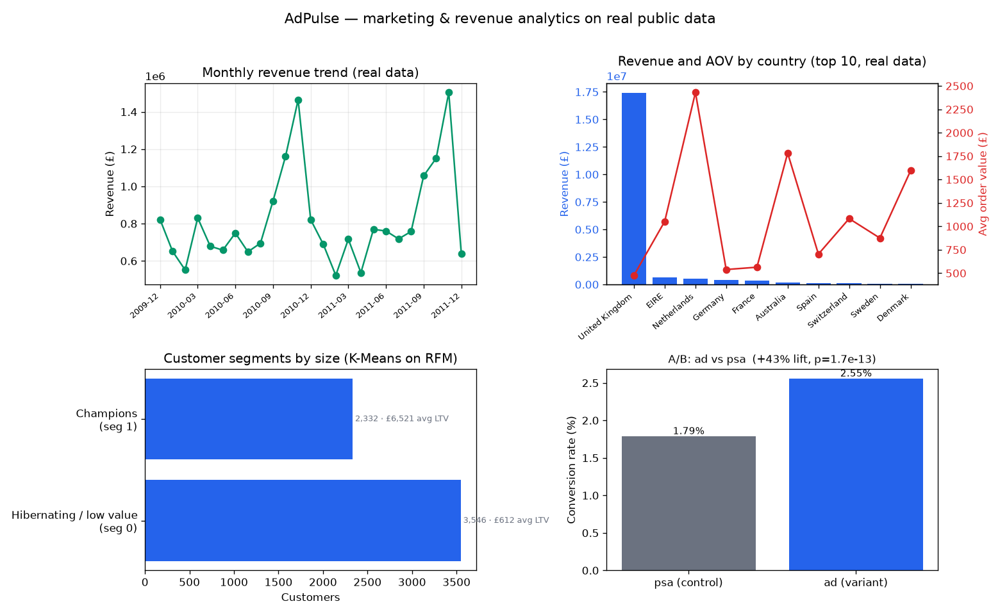
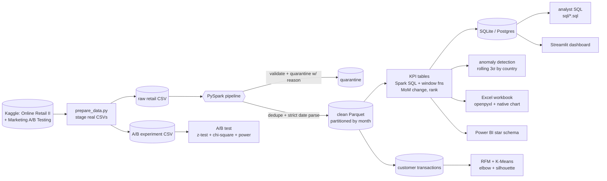
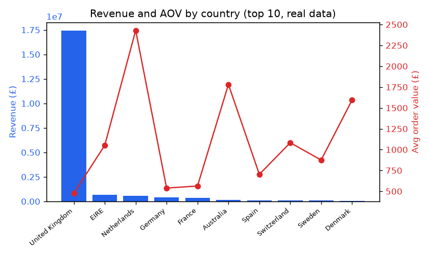

# AdPulse — Marketing & Revenue Analytics with PySpark, Segmentation & A/B Testing

[](https://github.com/immortalxmachine/adpulse/actions/workflows/ci.yml)


An end-to-end analytics project on **real public data**: clean and aggregate ~1M retail
transactions with **PySpark**, detect revenue anomalies, segment customers with **K-Means**,
validate a real advertising **A/B test**, and ship the results to **SQL**, **Excel**, a
**Power BI** star schema and a **Streamlit** dashboard.



> ✅ **All data is real public data — nothing is synthetic and no values are fabricated.**
> Two Kaggle datasets back the project:
> - **Online Retail II (UCI)** — `mashlyn/online-retail-ii-uci` (license **CC BY 4.0**) — a UK
>   online gift retailer's real transactions, Dec 2009 – Dec 2011. Drives the ELT, KPIs,
>   anomaly detection and segmentation. Currency is **GBP (£)**. No PII: the only identifier is
>   an anonymised integer `Customer ID`.
> - **Marketing A/B Testing** — `faviovaz/marketing-ab-testing` — a real experiment comparing an
>   `ad` group against a `psa` (public-service-ad) control, with a `converted` flag. Drives the
>   A/B test.
>
> Every number below is written by an actual run into [`metrics.json`](metrics.json) — nothing is
> hand-entered.

## Results at a glance (from the latest full run)

| Pipeline | Value |
|---|---|
| Raw rows ingested | **1,067,371** |
| Clean rows | **1,007,913** |
| Quarantined (cancellations / non-positive qty or price / bad dates) | **25,701** (2.41%) |
| Verbatim duplicate rows removed | **33,757** |
| Countries × months | 43 × 25 |

| Commercial performance (GBP) | Value |
|---|---|
| Revenue / orders / units | **£20,476,260** / 40,077 / 11,205,148 |
| Identified customers | **5,878** |
| Blended AOV / avg unit price | **£510.92** / **£1.83** |
| Top market (revenue) | United Kingdom **£17.4M** (85% of revenue) |
| Anomalous country-days flagged (rolling 3σ) | **327** (185 revenue, 142 orders) |

**A/B test** (`ad` treatment vs `psa` control): conversion rate **1.79% → 2.56%**, a **+43.1%**
relative lift — a genuine effect discovered in the data, not injected. Two-proportion z-test
**z = 7.37, p ≈ 1.7e-13 → highly significant** at α = 0.05; 95% CI on the absolute lift
**[+0.60pp, +0.94pp]**; chi-square cross-check agrees (χ² = 54.3, p ≈ 1.7e-13). The groups are
very unbalanced (564,577 `ad` vs 23,524 `psa`), so observed power is ~1.0 for this effect while
the small control group is what widens the interval.

**Customer segmentation** — RFM features + K-Means on **5,878** identified customers; k selected by
the silhouette score (best at **k = 2**, silhouette **0.44**) alongside the elbow curve:

| Segment | Customers | Avg recency (days) | Avg orders | Avg LTV |
|---|---|---|---|---|
| Champions | 2,332 | 51 | 12.7 | £6,521 |
| Hibernating / low value | 3,546 | 301 | 2.1 | £612 |

The high LTVs reflect that this is a **wholesale** retailer (large multi-unit invoices). A
transparent RFM-quantile model is also computed as an explainable baseline to compare against.

## Architecture



## Run it

```bash
# 1) create a virtual environment and install
python -m venv .venv && . .venv/bin/activate        # Windows: .venv\Scripts\activate
pip install -r requirements.txt -r requirements-dev.txt && pip install -e . --no-deps

# 2) fetch the real datasets from Kaggle into data/raw (needs a Kaggle API token)
kaggle datasets download mashlyn/online-retail-ii-uci -p data/raw/retail --unzip
kaggle datasets download faviovaz/marketing-ab-testing -p data/raw/ab --unzip

# 3) run the whole project end-to-end (stage -> Spark -> analytics -> DB -> reports)
python -m adpulse.run --scale full      # full datasets; writes metrics.json
#   or, for a fast smoke run on the committed real sample (no Kaggle needed):
python -m adpulse.run --scale ci

# 4) explore
streamlit run src/adpulse/dashboard.py
```

`python -m adpulse.run --scale full --download` will fetch the datasets for you if the `kaggle`
package is installed and configured. The small `data/sample/` subset (a real downsample, used by
the `ci` scale and CI) is committed so the pipeline runs without credentials.

Requires **Java 17** (PySpark 4 needs a JVM). Postgres and the Streamlit dashboard can also be
brought up together with Docker: `docker compose up --build`.

> **Windows note:** Spark's *native* Parquet write needs `winutils.exe`/`HADOOP_HOME`. Without
> it, the cleaned-Parquet lake write is skipped with a warning while every KPI is still computed
> (collected via pandas/pyarrow). The native write runs normally on Linux — see the green CI badge.

## What changed vs the earlier synthetic version

This project originally ran on a synthetic ad-impression generator. It was rebuilt on real public
data, keeping every technique the real data genuinely supports and **dropping** what it does not,
rather than fabricating values:

- **Kept:** the Spark ELT, data-quality quarantine (now on *real* dirt — cancellations, missing
  IDs, non-positive qty/price), Spark SQL **window functions** (MoM growth, rank), rolling-3σ
  anomaly detection, **RFM + K-Means** segmentation with elbow/silhouette and a quantile baseline,
  the **two-proportion z-test** A/B analysis with chi-square + power, SQL/Excel/Power BI/Streamlit.
- **Repointed:** channel×region×month ad KPIs → **country×month revenue KPIs**; per-campaign
  anomalies → per-country; the injected +12% creative lift → a **discovered +43% ad-vs-PSA lift**.
- **Dropped (honestly):** **CTR / CPC / CPA / ROAS** and the channel/creative/device dimensions —
  no non-synthetic Kaggle dataset pairs ad impressions, clicks and spend with revenue, so these
  would have required inventing numbers. The "never-purchased prospect" segment is also gone, as
  the retail data only contains customers who have purchased.

## What's inside

| Area | File | Highlights |
|---|---|---|
| Data staging | `src/adpulse/prepare_data.py` | validate / download the real Kaggle CSVs (no fabricated rows) |
| Data quality | `src/adpulse/data_quality.py` | quarantine rules + reasons for the *real* dirt (single source of truth) |
| KPI maths | `src/adpulse/kpis.py` | AOV / units-per-order / revenue-per-customer, zero-safe |
| Spark pipeline | `src/adpulse/spark_pipeline.py` | validate → quarantine → dedupe → partitioned Parquet → KPIs (window fns) |
| Anomaly detection | `src/adpulse/anomaly.py` | trailing rolling-z on daily revenue & orders, per country |
| Segmentation | `src/adpulse/segmentation.py` | RFM + K-Means, elbow + silhouette, quantile baseline |
| A/B testing | `src/adpulse/ab_test.py` | two-proportion z-test, CI, power, chi-square |
| Reporting | `report_excel.py`, `star_schema.py`, `dashboard.py` | Excel, Power BI star schema, Streamlit |
| Orchestration | `src/adpulse/run.py` | one command → `metrics.json` |
| SQL | `sql/*.sql` | 7 analyst queries (CTEs + window functions) |

See [`INTERVIEW_NOTES.md`](INTERVIEW_NOTES.md) for 22 Q&A tied to specific files/functions,
[`docs/backlog.md`](docs/backlog.md) for the Jira-style backlog, and
[`docs/powerbi.md`](docs/powerbi.md) for the Power BI model + DAX.

## Visuals

| Revenue & AOV by country | Customer segments | Choosing k |
|---|---|---|
|  |  |  |

## Quality

- **Tests:** `pytest` covers data staging, data-quality rules, KPI maths, RFM features, A/B statistics and anomaly detection.
- **Lint:** `ruff check .`
- **CI:** GitHub Actions sets up Java 17 + Python 3.13, runs lint + tests, then a full
  end-to-end pipeline **smoke test on the Linux runner** against the committed real sample
  (exercising the real Spark Parquet write).
