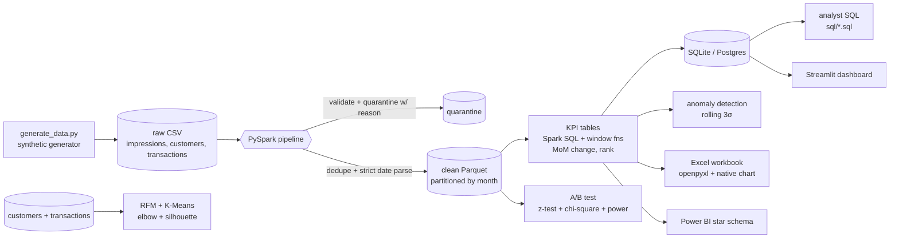
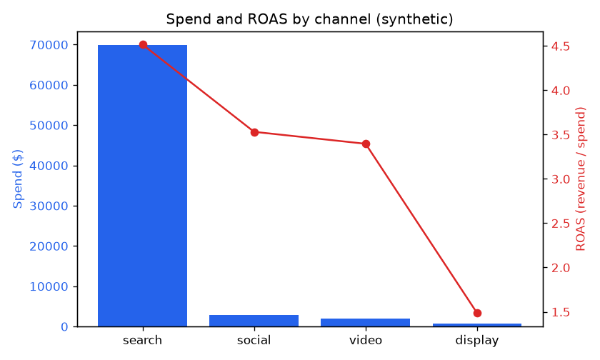
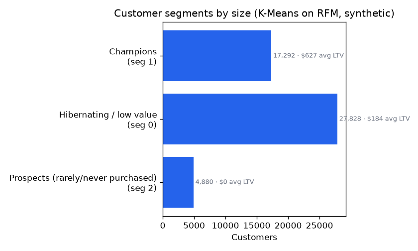
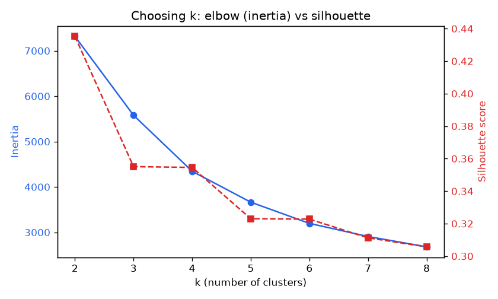

# AdPulse — Campaign Analytics with PySpark, Segmentation & A/B Testing

[](https://github.com/immortalxmachine/adpulse/actions/workflows/ci.yml)


An end-to-end digital-advertising analytics project: generate realistic (and deliberately
messy) ad data, clean and aggregate it with **PySpark**, detect anomalies, segment customers
with **K-Means**, validate a creative **A/B test**, and ship the results to **SQL**, **Excel**,
a **Power BI** star schema and a **Streamlit** dashboard.

> ⚠️ **All data is 100% synthetic**, generated locally by `src/adpulse/generate_data.py`.
> No real advertising, customer, or financial data is used. Every number below is written by
> an actual run into [`metrics.json`](metrics.json) — nothing is hand-entered.

## Results at a glance (from the latest full run)

| Pipeline | Value |
|---|---|
| Raw rows ingested | **2,010,000** |
| Clean rows | **1,969,399** |
| Quarantined (nulls / bad dates / negative spend) | **30,759** (1.53%) |
| Duplicate rows removed | **9,842** |
| Campaigns × months | 21 × 12 |

| Spend & return (synthetic) | Value |
|---|---|
| Impressions / clicks / conversions | 1,969,399 / 46,812 / 3,683 |
| Spend / revenue | **$75,477** / **$333,382** |
| Blended CTR / ROAS | **2.38%** / **4.42x** |
| Best channel (ROAS) | search **4.52x** (CPC $1.93, CPA $20.54) |
| Anomalous campaign-days flagged (rolling 3σ) | **427** (273 CTR, 154 spend) |

**A/B test** (creative_A vs creative_B on the flagship search campaign): conversion rate
**9.05% → 10.11%**, a **+11.7%** relative lift (injected ground truth was +12%).
Two-proportion z-test **z = 2.19, p = 0.028 → significant** at α = 0.05; 95% CI on the absolute
lift **[+0.11pp, +2.01pp]**; chi-square cross-check agrees (χ² = 4.82, p = 0.028).

**Customer segmentation** — RFM features + K-Means on 50,000 synthetic customers; k selected by
the silhouette score (best at **k = 3**, silhouette **0.45**) alongside the elbow curve:

| Segment | Customers | Avg recency (days) | Avg orders | Avg LTV |
|---|---|---|---|---|
| Champions | 17,292 | 58 | 6.7 | $627 |
| Hibernating / low value | 27,828 | 309 | 2.5 | $184 |
| Prospects (rarely/never purchased) | 4,880 | 459 | 0.0 | $0 |

A transparent RFM-quantile model is also computed as an explainable baseline to compare against.

## Architecture



## Run it (one command)

```bash
# 1) create a virtual environment and install
python -m venv .venv && . .venv/bin/activate        # Windows: .venv\Scripts\activate
pip install -r requirements.txt -r requirements-dev.txt && pip install -e . --no-deps

# 2) run the whole project end-to-end (generate -> Spark -> analytics -> DB -> reports)
python -m adpulse.run --scale full      # ~2M rows; writes metrics.json
#   or, for a fast smoke run (~20k rows):
python -m adpulse.run --scale ci

# 3) explore
streamlit run src/adpulse/dashboard.py
```

Requires **Java 17** (PySpark 4 needs a JVM). Postgres and the Streamlit dashboard can also be
brought up together with Docker: `docker compose up --build`.

> **Windows note:** Spark's *native* Parquet write needs `winutils.exe`/`HADOOP_HOME`. Without
> it, the cleaned-Parquet lake write is skipped with a warning while every KPI is still computed
> (collected via pandas/pyarrow). The native write runs normally on Linux — see the green CI badge.

## What's inside

| Area | File | Highlights |
|---|---|---|
| Synthetic data | `src/adpulse/generate_data.py` | 2M impressions, 50k customers, injected dirt, A/B lift, latent archetypes |
| Data quality | `src/adpulse/data_quality.py` | quarantine rules + reasons (single source of truth) |
| KPI maths | `src/adpulse/kpis.py` | CTR / CVR / CPC / CPA / ROAS, zero-safe |
| Spark pipeline | `src/adpulse/spark_pipeline.py` | validate → quarantine → dedupe → partitioned Parquet → KPIs (window fns) |
| Anomaly detection | `src/adpulse/anomaly.py` | trailing rolling-z (spend & CTR) |
| Segmentation | `src/adpulse/segmentation.py` | RFM + K-Means, elbow + silhouette, quantile baseline |
| A/B testing | `src/adpulse/ab_test.py` | two-proportion z-test, CI, power, chi-square |
| Reporting | `report_excel.py`, `star_schema.py`, `dashboard.py` | Excel, Power BI star schema, Streamlit |
| Orchestration | `src/adpulse/run.py` | one command → `metrics.json` |
| SQL | `sql/*.sql` | 7 analyst queries (CTEs + window functions) |

See [`INTERVIEW_NOTES.md`](INTERVIEW_NOTES.md) for 22 Q&A tied to specific files/functions,
[`docs/backlog.md`](docs/backlog.md) for the Jira-style backlog, and
[`docs/powerbi.md`](docs/powerbi.md) for the Power BI model + DAX.

## Visuals

| Channel performance | Customer segments | Choosing k |
|---|---|---|
|  |  |  |

## Quality

- **Tests:** `pytest` covers the generator, data-quality rules, KPI maths, A/B statistics and anomaly detection.
- **Lint:** `ruff check .`
- **CI:** GitHub Actions sets up Java 17 + Python 3.13, runs lint + tests, then a full
  end-to-end pipeline **smoke test on the Linux runner** (exercising the real Spark Parquet write).
